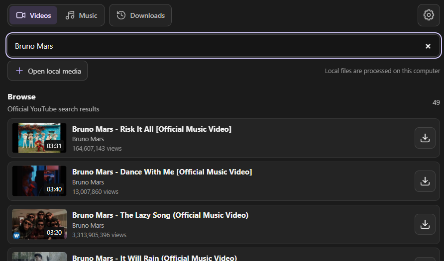
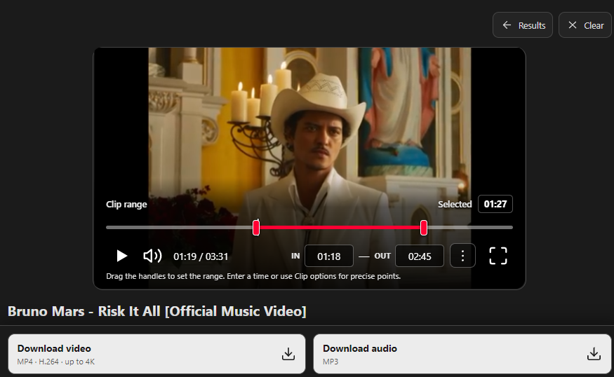
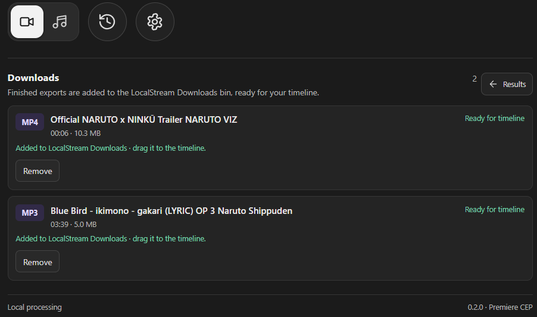
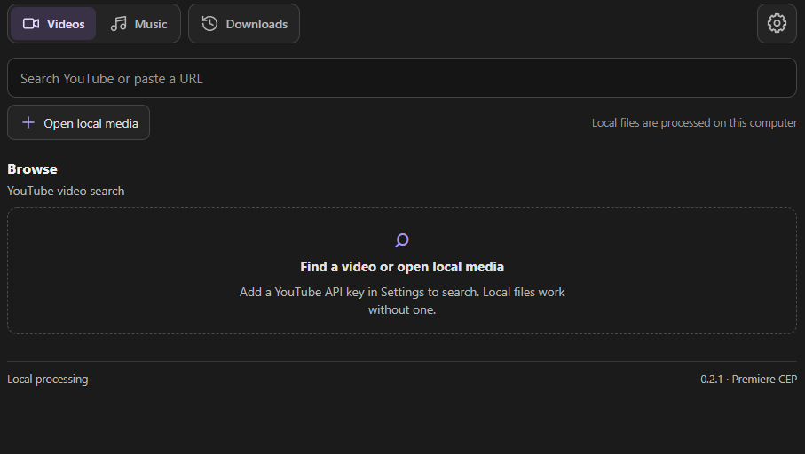
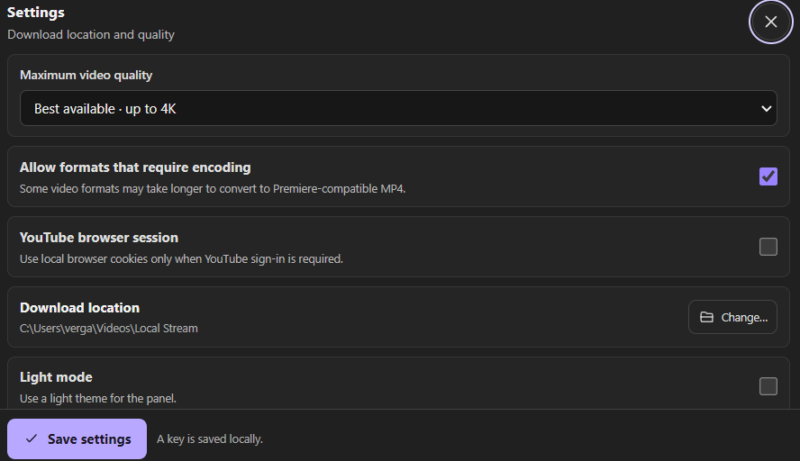
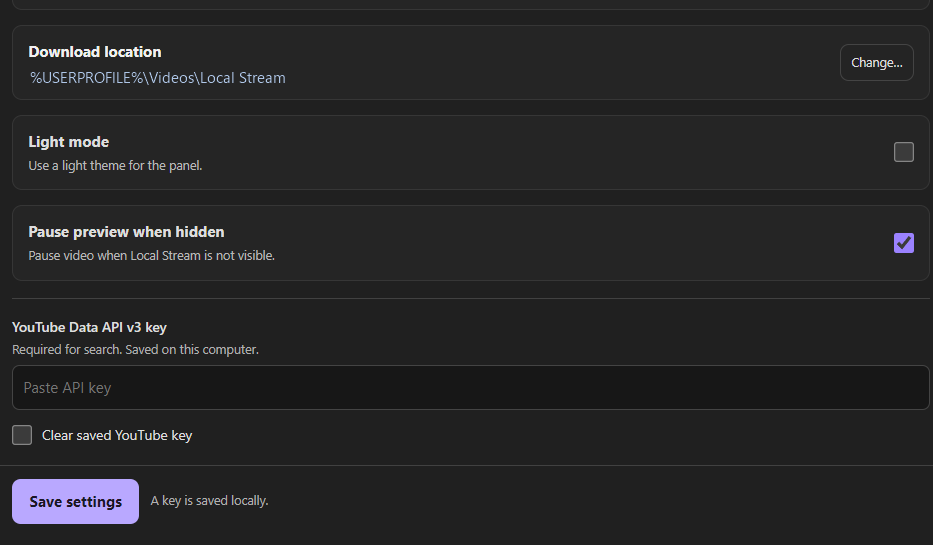

# Local Stream

**Search, preview, trim, and export media without leaving Adobe Premiere Pro.**

Local Stream is a CEP panel for Windows. It searches YouTube with your own Data API key, opens local media, and exports selected ranges as Premiere-friendly MP4 or MP3 files. Processing runs on your computer. Finished files appear in Recent Downloads with thumbnails and can be dragged into Premiere.

## Download

| Package | Use |
| --- | --- |
| **[Windows setup wizard (0.2.5)](https://github.com/Haejinka/Local-Stream/raw/refs/heads/main/dist/Local-Stream-Setup-0.2.5.exe)** | Recommended. Installs the panel and prepares required media tools. [SHA-256 checksum](https://github.com/Haejinka/Local-Stream/raw/refs/heads/main/dist/Local-Stream-Setup-0.2.5.exe.sha256). |
| [Signed ZXP (0.2.5)](https://github.com/Haejinka/Local-Stream/raw/refs/heads/main/dist/Local-Stream-0.2.5.zxp) | Manual installation through Adobe's Unified Plugin Installer. |

Close Premiere before running setup. The wizard uses Adobe Creative Cloud's Unified Plugin Installer and prepares Node.js, FFmpeg, FFprobe, and yt-dlp. See the [Windows setup guide](docs/INSTALLATION.md) for manual installation and troubleshooting.

## Features

- Search YouTube videos or music with official Data API results. Channel and playlist entries are excluded.
- Preview a result, set In and Out points in the player, and export the selected range as H.264/AAC MP4 or MP3.
- Open local media and use the same trimming and export controls.
- Follow download progress, browse recent exports with thumbnails, and drag finished files into a Premiere timeline or Project panel.
- Automatically add completed exports to the active project's `LocalStream Downloads` bin.
- Set maximum quality, output folder, and optional browser-session access in Settings.

## The panel

### Find a video

Search results show a thumbnail, duration, channel, view count, and a quick download action.



### Preview and trim

Set In and Out points on the player, then download the selected video or audio range.



### Use recent downloads

Recent Downloads keeps finished files in a compact list with thumbnails. Drag a file into Premiere or open its options menu.



<details>
<summary>More panel screenshots</summary>

### Browse before searching



### Configure downloads



### Configure the API key and preview behavior



</details>

## Requirements

- Windows 10 or 11.
- Adobe Premiere Pro 25.6 or later with CEP 12 support.
- Adobe Creative Cloud desktop app (provides Adobe's extension installer).
- A YouTube Data API v3 key for search.
- Internet access for YouTube search, preview, and source retrieval.
- The setup wizard provisions Node.js 20+, FFmpeg, FFprobe, and yt-dlp locally. Internet access is required to download any missing tools.

## Quick start: install with the setup wizard

1. Download and run `Local-Stream-Setup-0.2.5.exe` with Premiere closed.
2. Start Premiere and open **Window → Extensions (Legacy) → Local Stream**.
3. Open Settings, paste your YouTube Data API v3 key, and save.
4. Search, select a result, set the range, and choose **Download video** or **Download audio**.

See [the full Windows setup guide](docs/INSTALLATION.md) for API key creation, manual ZXP installation, privacy, and troubleshooting. Windows may show a SmartScreen warning because the community setup executable is not code-signed.

## Install from source

To work on the extension, download or clone this repository and run `scripts\install-cep.cmd`. This developer workflow installs the panel files directly and enables CEP developer mode for the current Windows user. The setup wizard is the recommended route for regular users.

## Build a ZXP for distribution

Run `scripts\build-setup.cmd` to create both the signed ZXP and Windows setup wizard. This requires Inno Setup 6.3 or 7 and Adobe's ZXPSignCmd; the first build downloads the signing tool and creates a self-signed certificate with a generated password protected by Windows DPAPI in your local app data. The ZXP and setup EXE are written to `dist`.

The private signing certificate and its Windows-user-encrypted password cache are kept outside this repository. The certificate verifies package integrity but does not establish a trusted publisher identity. See [distribution notes](docs/DISTRIBUTION.md) before publishing a release.

## YouTube API key and media permissions

Create a key for **YouTube Data API v3** in Google Cloud Console, enable that API for the project, and enter the key only in Local Stream's Settings. The key is saved locally under `%LOCALAPPDATA%\Adobe\CEP\extensionsData\com.localstream.premiere`; it is not part of this source repository or ZXP. Search uses the official Data API. Follow Google's key security guidance and restrict the key to the YouTube Data API where possible.

The project provides media retrieval and conversion features. Operators are responsible for complying with YouTube's terms, any written approval required for their use case, copyright, and the rights attached to each source. Approval or access held by one operator does not transfer to other users of this open-source project.

## Local processing and privacy

The CEP panel starts its companion Node.js backend on `127.0.0.1:47831`. A random local bearer token authenticates panel requests. Settings, the token, tool paths, and job history live in `%LOCALAPPDATA%\Adobe\CEP\extensionsData\com.localstream.premiere`; exports default to `%USERPROFILE%\Videos\Local Stream`. No Local Stream account or remote Local Stream service is required. YouTube services and the configured media source remain external network services.

The setup wizard asks Adobe's Unified Plugin Installer to install the signed CEP package for the current user. It does not enable developer mode. Settings, the backend token, tool paths, and job history remain in `%LOCALAPPDATA%\Adobe\CEP\extensionsData\com.localstream.premiere`; removing the panel preserves that data.

## Development

Requirements and test instructions are in [CONTRIBUTING.md](CONTRIBUTING.md). To start the backend during development, run `npm start`. The automated test suite can be run with `npm test`; it does not simulate Premiere's CEP or ExtendScript runtime.

## Project structure

```text
backend/             Local HTTP API, settings, download queue, and media processing
plugin/              CEP 12 panel, Premiere bridge, and extension manifest
scripts/             Windows installer, runtime setup, and ZXP packaging
docs/                Setup, release notes, and product screenshots
test/                Automated backend and media processing tests
```

## License

Local Stream is available under the [MIT License](LICENSE).

## Adobe references

- [CEP 12 HTML Extension Cookbook](https://github.com/Adobe-CEP/CEP-Resources/blob/master/CEP_12.x/Documentation/CEP%2012%20HTML%20Extension%20Cookbook.md)
- [Adobe CEP resources and CSInterface.js](https://github.com/Adobe-CEP/CEP-Resources)
- [Adobe's Premiere Pro panel sample](https://github.com/Adobe-CEP/Samples/tree/master/PProPanel)
